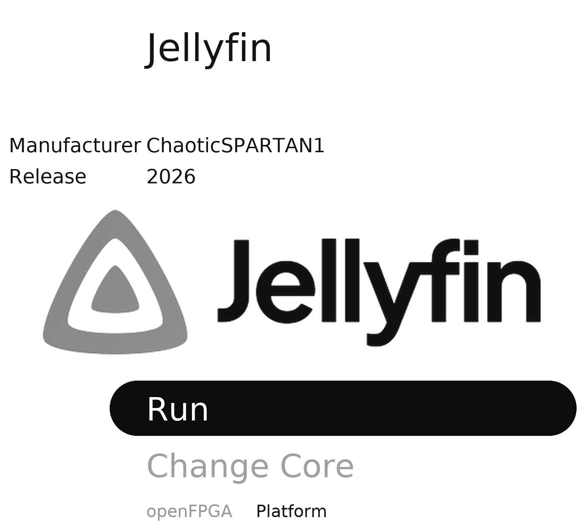
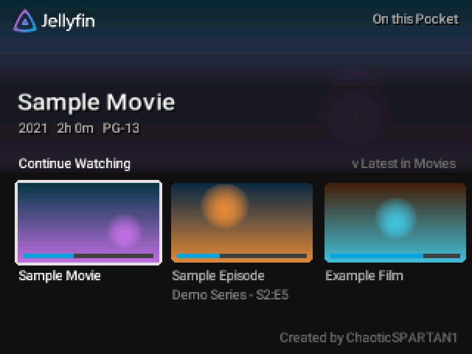
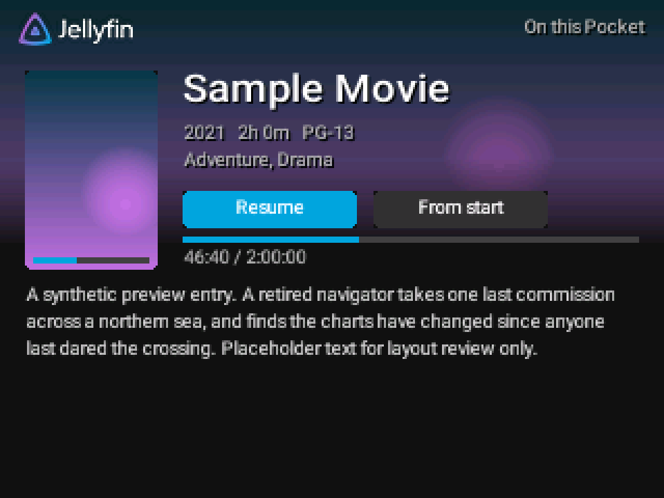
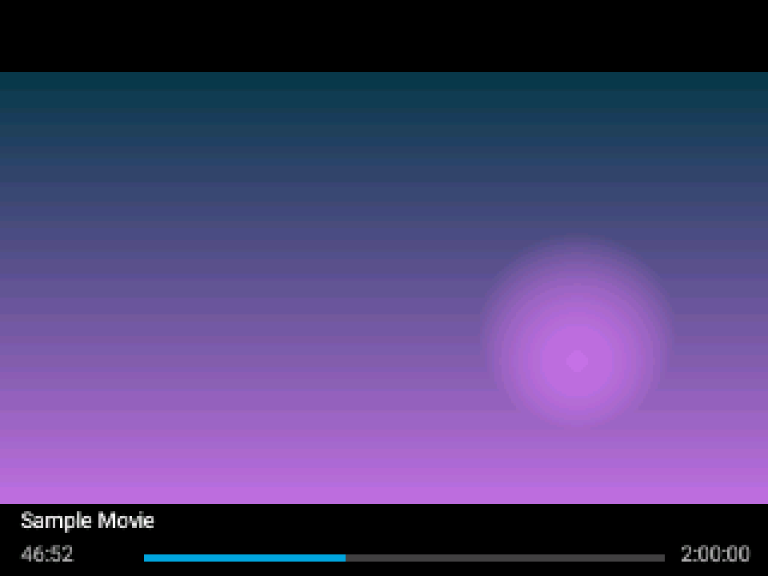

  <picture>
    <source media="(prefers-color-scheme: dark)" srcset="docs/images/pocketfin-logo-dark.png">
    <source media="(prefers-color-scheme: light)" srcset="docs/images/pocketfin-logo.png">
    
  </picture>

# PocketFin: Jellyfin on your Analogue Pocket

 
The core's launch screen, redrawn from the core's own files. Jellyfin logo (c) the Jellyfin contributors, CC BY-SA 4.0.

PocketFin is an openFPGA core and app that brings a Jellyfin-style media library to the Analogue
Pocket. It plays video with sound using a JPEG decoder built into the FPGA. On the Pocket it appears
as the core **Jellyfin** (made by ChaoticSPARTAN1).

**Watch videos straight from the SD card, no network or extra hardware needed.** Put your own videos
on the card and they show up in the **On this Pocket** tile on the Home screen.

### Add your own videos to the card (short version)

1. Install PocketFin on the card first ([Install](docs/Install.md)).
2. On a Windows PC, install [Python 3.12+](https://www.python.org/downloads/), FFmpeg (for example
   `winget install Gyan.FFmpeg`) and PyAV: `py -3 -m pip install av`. FFmpeg and PyAV are separate
   free software under their own licences (FFmpeg: LGPL or GPL depending on the build; PyAV: BSD) and
   are not included in PocketFin. See [What you need](docs/What-You-Need.md).
3. Download this repository (green **Code** button, **Download ZIP**) and unzip it.
4. In that folder, run: `py -3 tools\make_offline_library.py --video "C:\Videos\My Video.mp4"`
   (add more `--video "..."` for more files).
5. It converts each video to the Pocket's format (256x144 pictures at the video's own frame rate, about
   0.9 GB per hour) and writes the result to `build\offline-library\`.
6. Copy everything inside `build\offline-library\` onto the root of the Pocket's SD card and allow it
   to replace files. Its files go to `Assets\pocketlive\common\` and `Assets\pocketlive\ChaoticSPARTAN1.Jellyfin\`.
7. Put the card back, open the Jellyfin core and press **A**: your videos are in **On this Pocket**.

Limits: up to 256 videos, 12 pack files of 2 GiB each (about 24 hours in total). Only add videos you
own or have the right to copy. Details and troubleshooting: [Offline library](docs/Offline-Library.md).

## What it does

- **Jellyfin-style screens**: Home rows (Continue Watching, Next Up, Latest), My Media, details pages,
  posters and a resume bar, in the style of the official Jellyfin apps.
- **Offline library on the SD card**: your own videos, or titles copied from your Jellyfin server.
- **Live Jellyfin over the link cable**: the Pocket has no Wi-Fi, but with a ModRetro Chromatic running
  [Jellymatic](https://github.com/ChaoticSPARTAN1/Jellymatic) and a link cable, the Pocket
  browses your server and streams from it ([how](docs/Wireless-Jellyfin.md)).
- **Each title at its own frame rate** (24, 25 or 30 fps), resume where you stopped, watched marks.

| Home | Details | Playing |
|---|---|---|
|  |  |  |

Screenshots come from the project's own screen renderer with made-up sample titles.

## Quick start

1. Download this repository and unzip it.
2. Copy the contents of `release\SD\` onto the root of your Pocket's SD card. Then, **first install
   only (skip if the card already has them)**, also copy `release\SD-sample-library\` and
   `release\SD-first-install-saves\`. Or, on Windows, run `.\Install-PocketFin.ps1 -Card E:\` (use
   your card's drive letter). [Full steps](docs/Install.md).
3. On the Pocket: **Openfpga** (or the core list) > **Jellyfin** > **Run**. Press **A** and play the
   built-in **Test Pattern** to check picture and sound.

## Documentation

The [docs](docs/Home.md) cover everything in plain steps: [What you need](docs/What-You-Need.md),
[Install](docs/Install.md), [First run](docs/First-Run.md), [Using PocketFin](docs/Using-PocketFin.md),
[Connecting to Jellyfin wirelessly](docs/Wireless-Jellyfin.md), [Offline library](docs/Offline-Library.md),
[Troubleshooting and recovery](docs/Troubleshooting.md), [FAQ](docs/FAQ.md),
[Building from source](docs/Building-from-Source.md), [AI prompt examples](docs/AI-Prompt-Examples.md),
[Credits and licences](docs/Credits-and-Licences.md).

### Optional: Remote Pilot for the Chromatic side

[Remote Pilot](https://github.com/ChaoticSPARTAN1/RemotePilot) is a free PC companion for the
Chromatic (with Jellymatic): it shows the Chromatic's screen in your web browser and lets you press its
buttons and read its logs from the PC, over USB or Wi-Fi. For PocketFin users it makes the Chromatic
side easier: set up its Wi-Fi, Jellyfin sign-in and Pocket link from your desk, and troubleshoot the
link without juggling two handhelds. Its privacy eye (on by default) hides addresses and network names
on screen, which helps when you make a bug report, and an AI assistant such as Claude or Codex can use
it to help you test. It is optional: you do not need it to play videos from the SD card.
More: [Connecting to Jellyfin wirelessly](docs/Wireless-Jellyfin.md#optional-remote-pilot).

## Related projects

- [Jellymatic](https://github.com/ChaoticSPARTAN1/Jellymatic): Jellyfin on the ModRetro Chromatic, and
  the Chromatic side of the link-cable connection.
- [RemotePilot](https://github.com/ChaoticSPARTAN1/RemotePilot): see and control a Chromatic
  from your PC (screen, buttons, logs) over USB or Wi-Fi.

## Status

Version 1.0.0. The app in `release/` (`pjlive.elf`) was built from this source. The bitstream and OS
kernel are the files that have run on an Analogue Pocket (only `core.json` gained the version number
and project link). The previous app build (SHA-256 `a19aa677...`) was tested on a Pocket; this build
changes only the About screen's text and the source of the font atlas, which is now generated directly
from Google's Roboto font (same glyph sizes and spacing; only tiny anti-aliasing differences). Live streaming through a Chromatic works but is
limited by the link cable: pictures are small and soft, and playback may pause briefly to refill. See the [FAQ](docs/FAQ.md).

## Disclaimer

PocketFin is an independent project, not affiliated with, endorsed by or supported by Analogue or the
Jellyfin project. Analogue and Analogue Pocket are trademarks of Analogue Enterprises Limited.
Jellyfin is a trademark of its owners; the Jellyfin logo is used under CC BY-SA 4.0. ModRetro and
Chromatic are trademarks of ModRetro, Inc.; PocketFin is not affiliated with ModRetro either.
Use it at your own risk. It is provided as is, without warranty, and support is not guaranteed.

## Contributing

Bug reports, fixes and pull requests are welcome: see [CONTRIBUTING.md](CONTRIBUTING.md). Report
security problems privately: see [SECURITY.md](SECURITY.md).

## Licence

PocketFin is free software: GPL-3.0-or-later ([LICENSE](LICENSE)), with additional terms and one
additional permission under GPL section 7 ([ADDITIONAL-TERMS.md](ADDITIONAL-TERMS.md)):

- keep the author attribution "ChaoticSPARTAN1" in the credits and in any About or credits screen
  (section 7(b)), and do not misrepresent the origin of the work (section 7(c));
- you may convey the FPGA bitstream, which combines PocketFin with the Analogue Pocket Framework and
  Intel/Altera FPGA IP; its Corresponding Source need not include the source of those parts.

Third-party parts keep their own licences ([THIRD-PARTY-NOTICES.md](THIRD-PARTY-NOTICES.md)).

## Credits

- **Created by ChaoticSPARTAN1.**
- openfpgaOS runtime and SDK by ThinkElastic (Apache-2.0).
- core_jpeg hardware JPEG decoder by Ultra-Embedded.com (Apache-2.0).
- VexiiRiscv CPU by SpinalHDL (MIT).
- Roboto font by Google (Apache-2.0); the app's glyph atlas is generated from it by `tools/build_roboto_atlas.py`.
- musl libc, dlmalloc, lib9660 and cram0_phy by their authors (MIT, MIT-0, ISC, MIT).
- Jellyfin logo by the Jellyfin contributors (CC BY-SA 4.0).
- Analogue Pocket Framework by Analogue.

Full list: [Credits and licences](docs/Credits-and-Licences.md).
