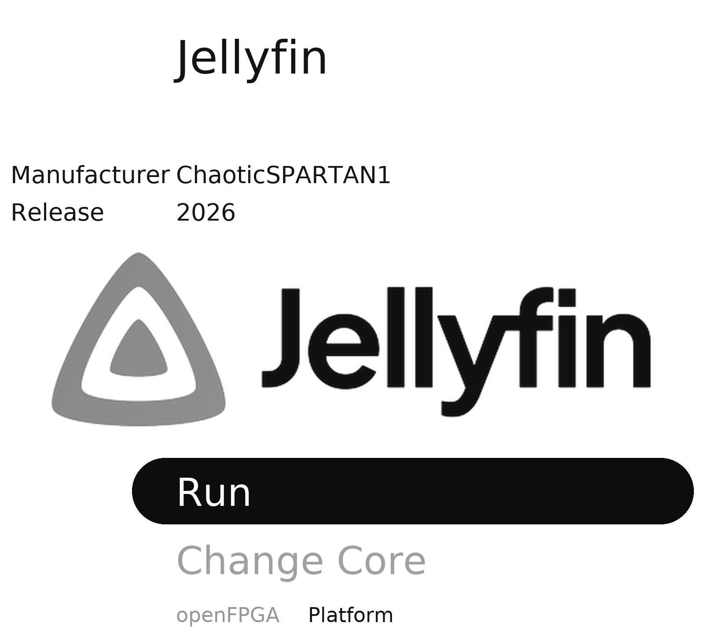
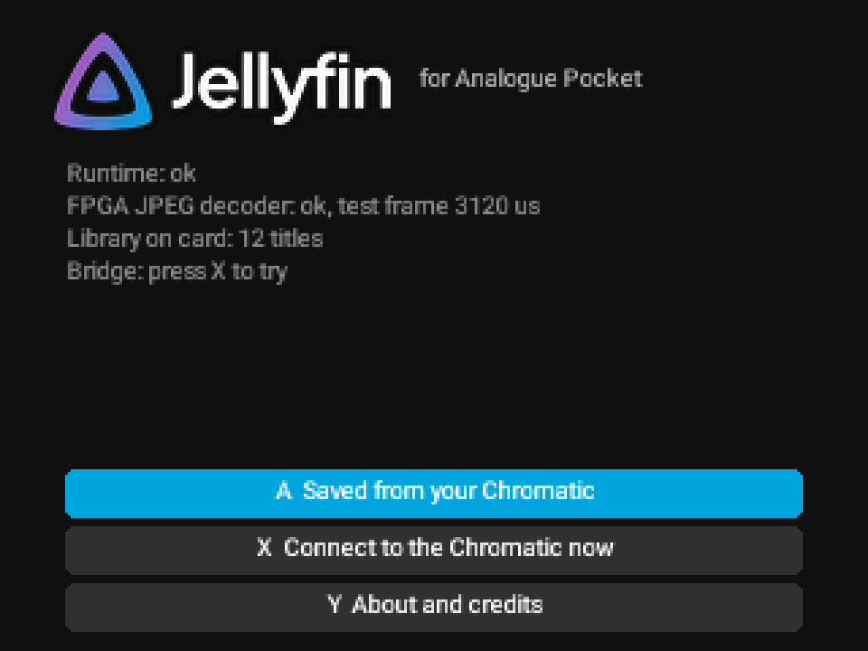
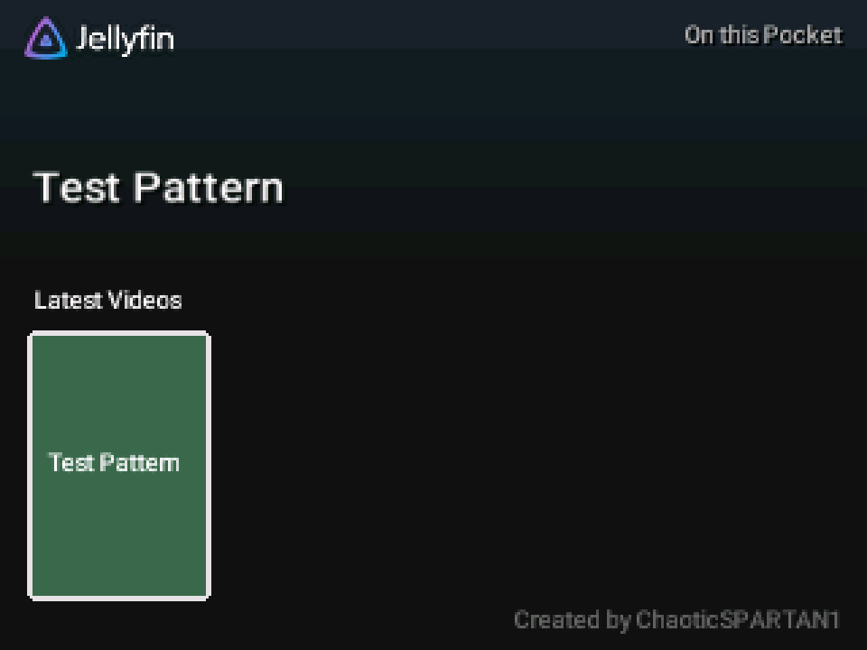
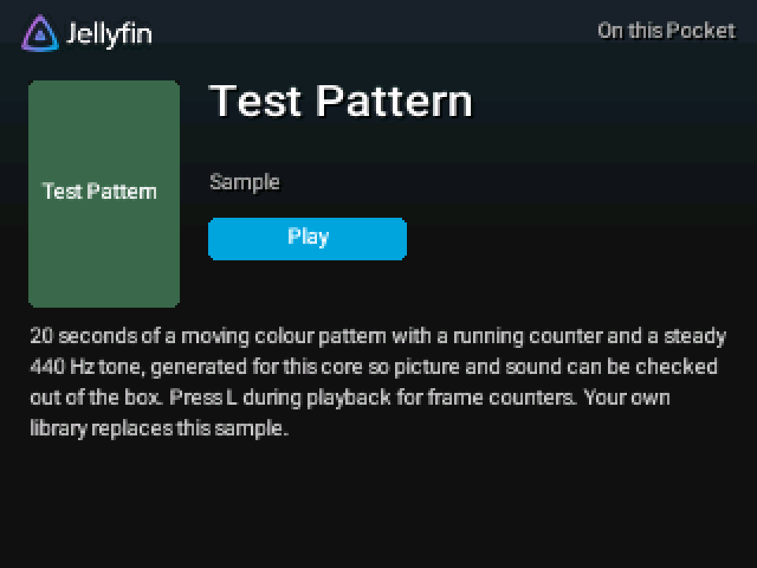

# First run

[Home](Home.md) > First run

- [Start the core](#start-the-core)
- [The start screen](#the-start-screen)
- [Play the test pattern](#play-the-test-pattern)
- [Quitting](#quitting)

## Start the core

1. Turn on the Pocket.
2. Open **openFPGA** in the main menu (on some firmware it is the core list), choose **Jellyfin**,
   then **Run**.

It takes a few seconds to load. The app tests its own JPEG decoder at every start.

## The start screen

- The top lines show the self-test: **Runtime: ok** and **FPGA JPEG decoder: ok** mean the core works.
  **Library on card** shows how many titles are on the card.
- **A** opens a library: the one on this Pocket, or the one saved from your Chromatic if you have used
  one before (then **Select** opens the card's library instead).
- **X** looks for a Chromatic on the link cable now. It also looks by itself every few seconds.
- **Y** shows **About and credits**.

## Play the test pattern

1. Press **A**. Home opens with the built-in **Test Pattern**.
2. Press **A** on it to open its details, then **A** again to play.
3. You should see moving colour bars with a running counter and hear a steady tone. Press **L** to show
   frame counters, **B** to stop.

If picture and sound work, the core is installed correctly. Next, add your own videos
([Offline library](Offline-Library.md)) or connect to your server ([Wireless](Wireless-Jellyfin.md)).

## Quitting

Use the Pocket's own menu (the Analogue button) and quit the core. **B** on the start screen does not
quit; it shows that hint instead. Quitting properly lets the Pocket save the app's log, where you
stopped each title and the saved Chromatic library to the card.

Next: [Using PocketFin](Using-PocketFin.md)
