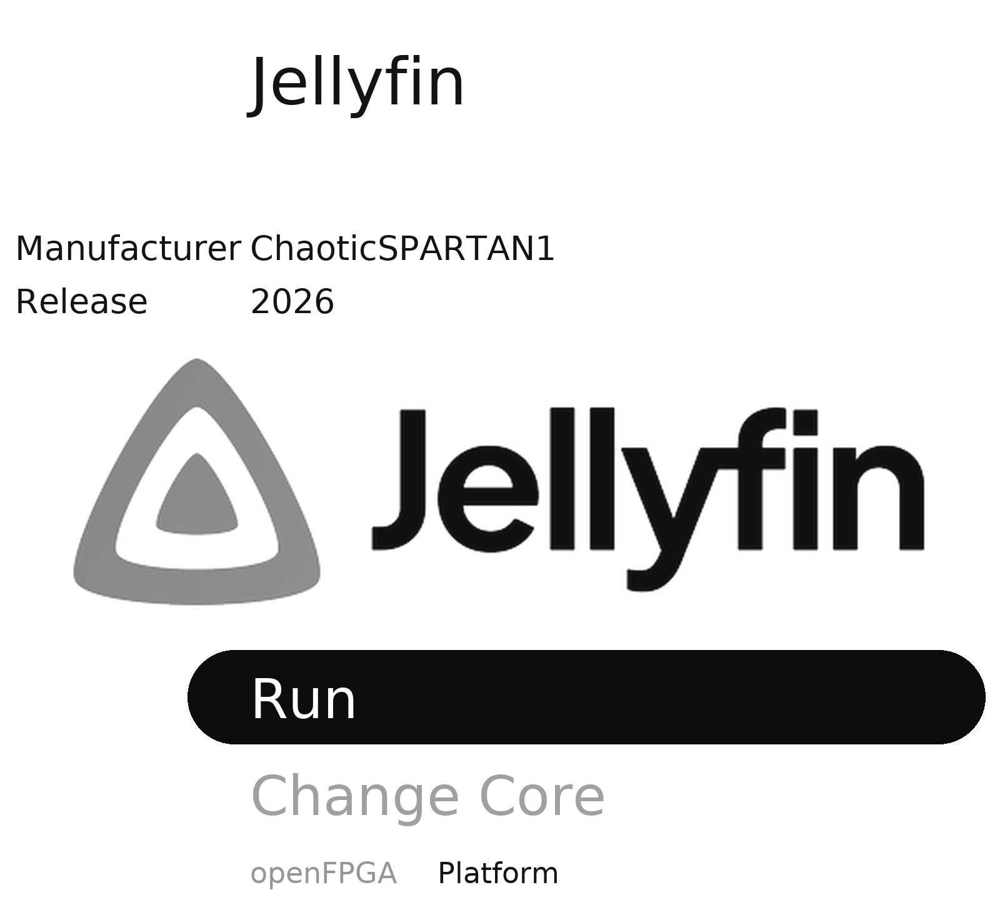

# PocketFin wiki

PocketFin puts a Jellyfin-style media library on the Analogue Pocket. It runs as an openFPGA core
called **Jellyfin**. You can watch videos stored on the SD card with nothing else, or browse and
stream your Jellyfin server through a ModRetro Chromatic and a link cable.

*The core's launch screen. Jellyfin logo (c) the Jellyfin contributors, CC BY-SA 4.0.*

## Pages

| Page | What it covers |
|---|---|
| [What you need](What-You-Need.md) | The Pocket, an SD card, and what is optional |
| [Install](Install.md) | Copying PocketFin onto the SD card, updating, removing |
| [First run](First-Run.md) | Starting the core and playing the test pattern |
| [Using PocketFin](Using-PocketFin.md) | Buttons, Home rows, On this Pocket, playback, quality |
| [Connecting to Jellyfin wirelessly](Wireless-Jellyfin.md) | The Chromatic link and setting up a Jellyfin server at home |
| [Offline library](Offline-Library.md) | Putting your own videos (or server titles) on the card |
| [Troubleshooting and recovery](Troubleshooting.md) | Black screen, flashing backlight, going back to the previous files |
| [FAQ](FAQ.md) | Short answers |
| [Building from source](Building-from-Source.md) | Rebuilding the app, the core and the release |
| [AI prompt examples](AI-Prompt-Examples.md) | Ready-made prompts for Claude, Codex and other assistants |
| [Credits and licences](Credits-and-Licences.md) | Who made what, and under which licence |

## Related projects

- [Jellymatic](https://github.com/ChaoticSPARTAN1/Jellymatic): Jellyfin on the ModRetro Chromatic and
  the Chromatic side of the link cable.
- [RemotePilot](https://github.com/ChaoticSPARTAN1/RemotePilot): an optional PC companion that
  shows and controls the Chromatic from your PC ([why it helps](Wireless-Jellyfin.md#optional-remote-pilot)).

## Disclaimer

PocketFin is an independent project, not affiliated with, endorsed by or supported by Analogue, ModRetro or
the Jellyfin project. Jellyfin is a trademark of its owners. Use it at your own risk; support is not
guaranteed.
