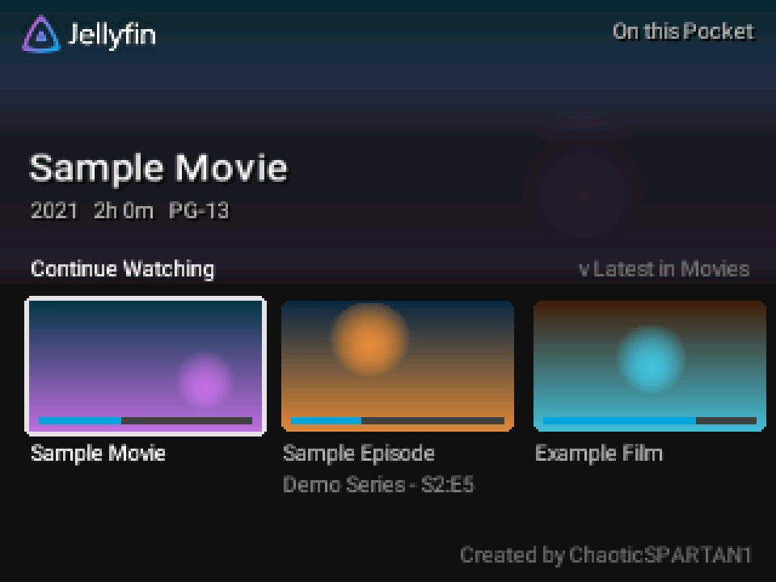
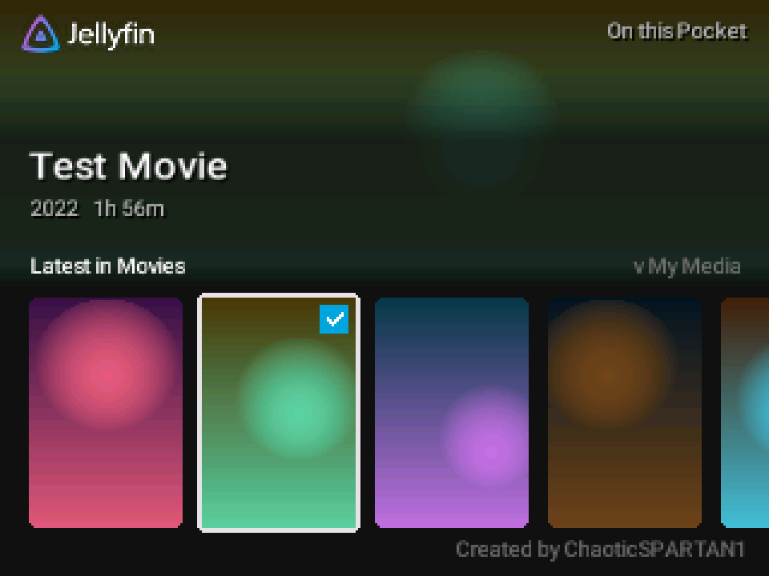
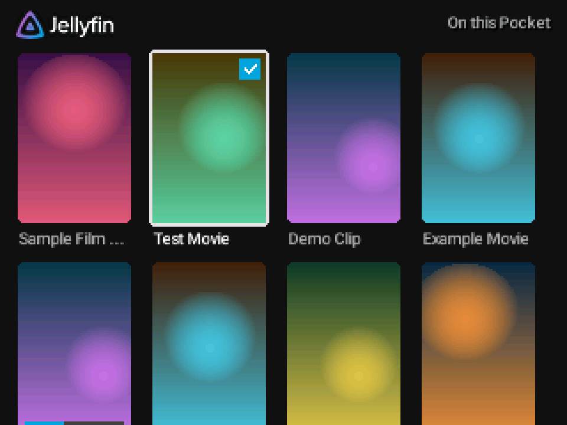
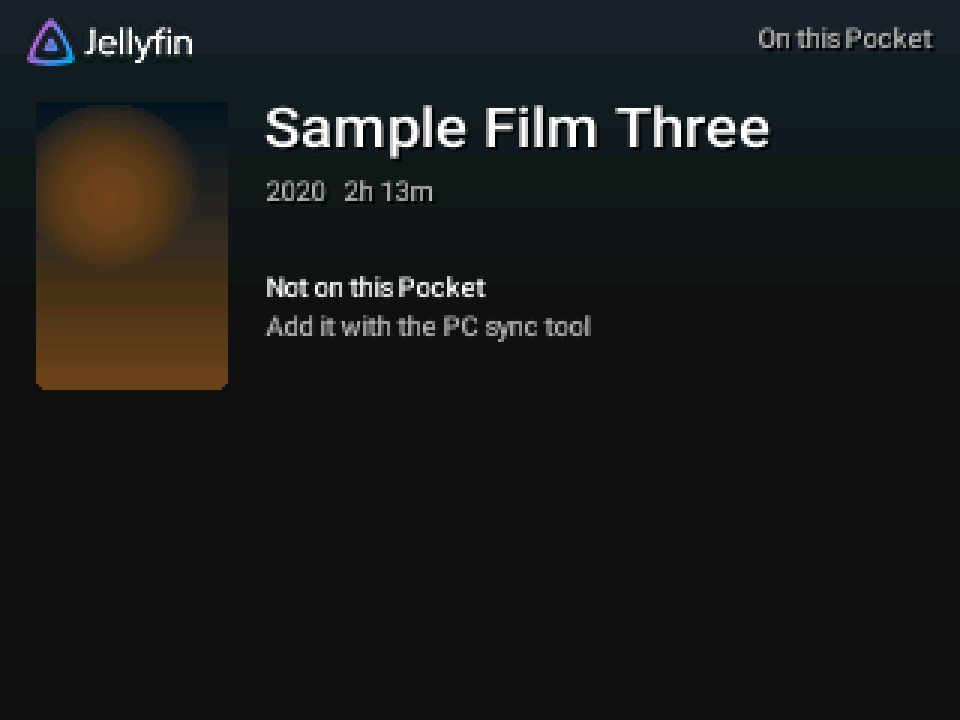
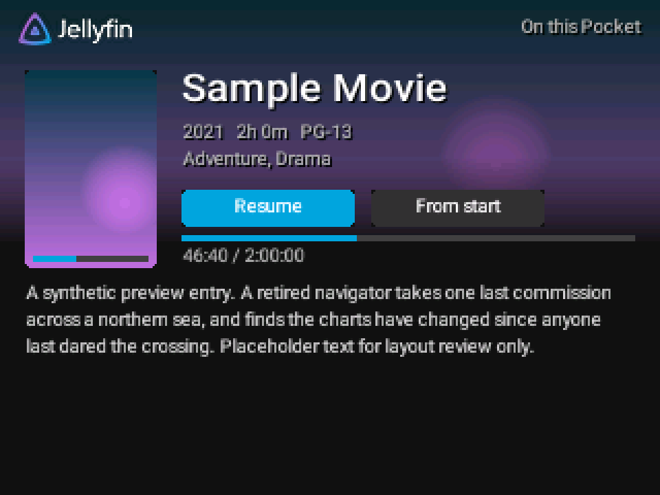
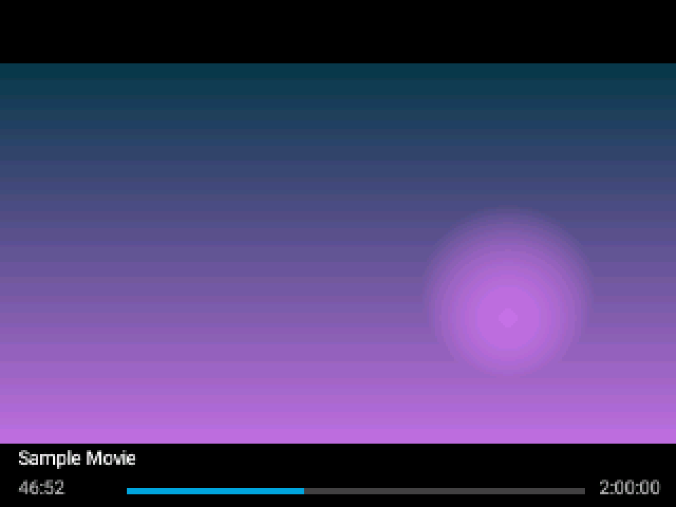

# Using PocketFin

[Home](Home.md) > Using PocketFin

- [Buttons](#buttons)
- [Home](#home)
- [On this Pocket](#on-this-pocket)
- [Details and playback](#details-and-playback)
- [Frame rate and picture quality](#frame-rate-and-picture-quality)
- [Settings in the Pocket's menu](#settings-in-the-pockets-menu)

## Buttons

| Where | Button | What it does |
|---|---|---|
| Start screen | A | Open a library (this Pocket's, or the one saved from your Chromatic) |
| | Select | Open this Pocket's library when a saved Chromatic library also exists |
| | X | Look for a Chromatic on the link cable now |
| | Y | About and credits (B or Y returns) |
| Home and folders | D-pad | Move between rows (up/down) and titles (left/right) |
| | A | Open the title or folder |
| | X | Play the selected title from the start |
| | B | Back |
| | Y | Go to Home |
| | L / R | Previous / next page in a large folder |
| | Select | With this Pocket's library: back to the start screen. With a Chromatic: change the frame-rate limit |
| Details | A | Play, or Resume / From start (choose with left/right) |
| | X | Play from the start |
| | B | Back |
| While playing | Start | Pause; Start or A resumes |
| | Left / Right | Jump back / forward 10 seconds |
| | B | Stop (the position is kept for Resume) |
| | L | Show playback numbers, then (with a Chromatic) link numbers, then hide |
| | R | Film mode on/off: the screen refresh follows the video's frame rate |

To quit the core, use the Pocket's own menu (Analogue button).

## Home

Home works like the Jellyfin apps: a large picture of the selected title at the top, then rows such as
**Continue Watching**, **Next Up**, **Latest in Movies** and **My Media** (your libraries as tiles).
Titles you started have a progress bar; watched titles have a tick. The top right says where the
library comes from: **On this Pocket**, or **Chromatic connected**.

 

## On this Pocket

Everything stored on the SD card opens from the **On this Pocket** tile, at the end of the **My Media**
row. It is there both when you use the card on its own and when a Chromatic is connected, so your own
videos are always one tile away. Titles that are listed but not stored on the card say **Not on this
Pocket**.

## Details and playback

 

The details page shows the year, length, rating, genres and description, with **Resume** and **From
start** when you stopped part way. During playback a strip shows the title and progress for a few
seconds after each button press. Where you stopped and what you watched are saved on the Pocket and
written to the card when you quit the core.

## Frame rate and picture quality

- **From the card**: each title plays at its own frame rate (23.976, 24, 25, 29.97 or 30 fps) at
  256x144. Faster videos were halved when they were converted.
- **From a Chromatic**: the picture comes from your server through the link cable, so it is smaller
  (about 128x72) and softer. **Select** cycles the frame-rate limit between 24, 30 and 60 fps; a 24 fps
  film still plays at 24. The link may not carry the higher rates; the app then says what rate it
  plays at. See [Connecting to Jellyfin wirelessly](Wireless-Jellyfin.md).

## Settings in the Pocket's menu

The Pocket's **Core Settings** and **Controls** screens for this core still show labels left over from
the openFPGA template it is built on (for example Analogizer options and game-style button names).
PocketFin ignores them; leave them as they are. The app uses its own defaults: link speed Auto
(384 kHz, falling back to 256 kHz), a 2-second buffer, normal volume.

Next: [Connecting to Jellyfin wirelessly](Wireless-Jellyfin.md)
