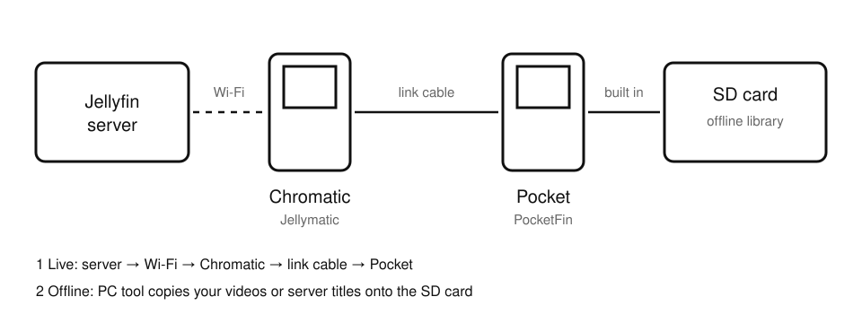
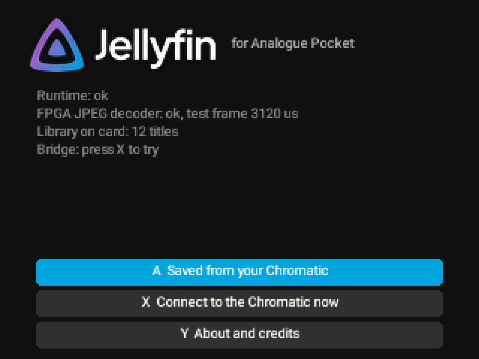

# Connecting to Jellyfin wirelessly

[Home](Home.md) > Connecting to Jellyfin wirelessly

- [The two ways to get your library](#the-two-ways-to-get-your-library)
- [Set up a Jellyfin server at home](#set-up-a-jellyfin-server-at-home)
- [Connect through a Chromatic](#connect-through-a-chromatic)
- [What to expect](#what-to-expect)
- [Optional: Remote Pilot](#optional-remote-pilot)
- [Privacy](#privacy)

## The two ways to get your library

The Analogue Pocket has **no Wi-Fi**. PocketFin supports two ways to use your Jellyfin server:

1. **Live, through a ModRetro Chromatic.** The Chromatic joins your Wi-Fi and talks to your server;
   the Pocket talks to the Chromatic through a link cable. You browse your server's Home,
   folders and posters on the Pocket and stream titles. The Chromatic needs
   [Jellymatic](https://github.com/ChaoticSPARTAN1/Jellymatic).
2. **Copied to the card from a PC.** `tools/make_offline_library.py --jellyfin` copies titles from your
   server to the SD card, with their posters and descriptions. No wireless at all; see
   [Offline library](Offline-Library.md).

There is no direct PC-to-Pocket wireless connection.

## Set up a Jellyfin server at home

Jellyfin is free media-server software. If you already have a server, skip to the next part.

1. On a computer that stays on at home (a PC or a NAS), download Jellyfin Server from
   https://jellyfin.org/downloads and install it.
2. On that computer, open a web browser at `http://localhost:8096` and follow the setup: create your
   user name and password, and add your libraries (for example a **Movies** folder and a **Shows**
   folder).
3. Find the server's address on your home network. In the Jellyfin dashboard it is listed under
   **Networking**; it looks like `http://your-server:8096` (your computer's name or local address and
   port 8096).
4. Leave **transcoding** turned on (it is on by default): the server converts video into the small
   format the Chromatic and Pocket can show.
5. Keep the server on the same home network as the Chromatic.

## Connect through a Chromatic

1. Install Jellymatic on the Chromatic and set it up there: Wi-Fi network, server address and sign-in
   (follow the Jellymatic instructions). Check that the Chromatic itself can browse your server.
2. Connect the Pocket and the Chromatic with a link cable.
3. On the Pocket, start the **Jellyfin** core. It looks for a Chromatic by itself every few seconds
   (or press **X** on the start screen).
4. On the Chromatic, open Jellyfin and choose **Pocket link** (in Jellymatic's menu).
5. The Pocket's header changes to **Chromatic connected** and your server's Home appears.

While connected, the Pocket quietly saves your Home, folders and posters. When you unplug the cable,
that saved library stays browsable (titles that are not on the card are dimmed), and the app goes back
to the Chromatic when you plug it in again.

## What to expect

- The link cable is slow (a few tens of kilobytes per second). Pictures are about 128x72 and soft,
  and playback may pause now and then to refill its buffer.
- Browsing, posters and descriptions work well; the first visit to Home takes a little while, later
  visits come from the saved copy.
- For the best picture, copy titles to the card instead ([Offline library](Offline-Library.md)).
- The connection uses only the link cable; the Pocket never sees your server address, password or
  tokens. Those stay on the Chromatic.

## Optional: Remote Pilot

[Remote Pilot](https://github.com/ChaoticSPARTAN1/RemotePilot) is a free program for your
Windows PC that shows the Chromatic's screen in a web browser, and lets you press its buttons, read its
logs and save screenshots, over a USB cable or your home Wi-Fi. It works with a Chromatic running
Jellymatic. You do not need it for PocketFin; it just makes the Chromatic side easier:

- **First-time setup from your desk**: go through the Chromatic's Wi-Fi, Jellyfin sign-in and Pocket
  link screens with the on-screen buttons, while watching the Chromatic's screen large on the PC.
- **Troubleshooting the link**: watch the Chromatic's screen and log on the PC while you hold the
  Pocket, instead of juggling two handhelds.
- **Cleaner bug reports**: its privacy eye (on by default) hides addresses and network names on the
  screen. Saved files are not masked, so check them before sharing.
- **Help from an AI assistant**: Claude, Codex or another assistant can drive the Chromatic through it
  to help you test, within the safety rules in its documentation.

It is not needed to play videos from the SD card.

## Privacy

Your Wi-Fi details and server sign-in are set on the Chromatic (or, for the PC tool, in
`private/jellyfin-connection.txt` on your PC, which Git ignores). Never post them in issues, logs or
screenshots; see [SECURITY.md](../SECURITY.md).

Next: [Offline library](Offline-Library.md)
